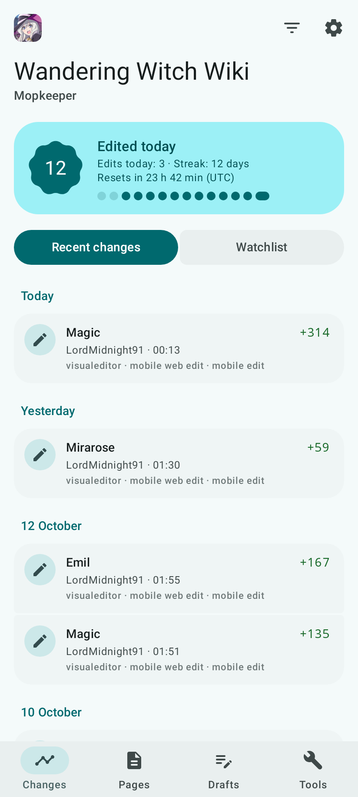
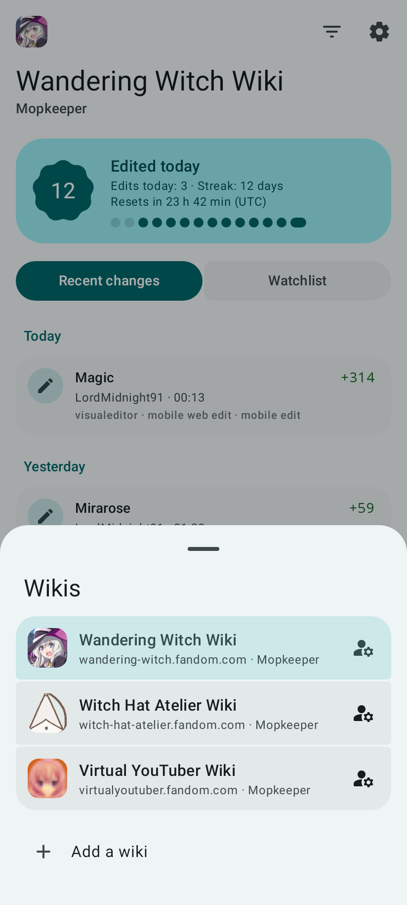
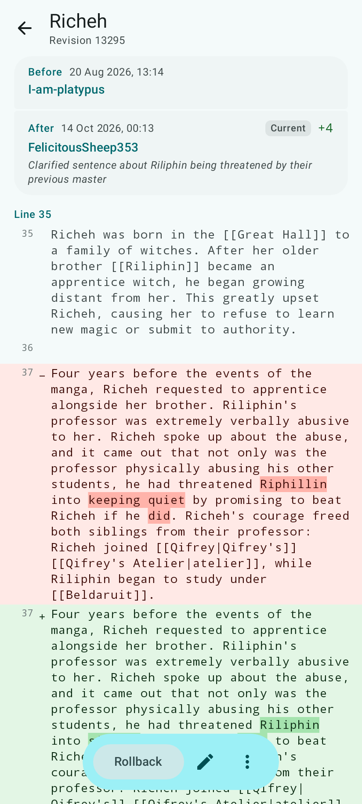
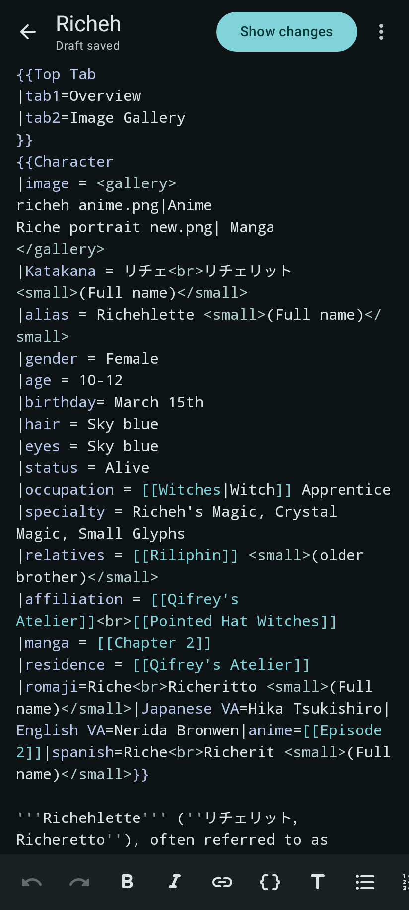

# WikiMop

Watch recent changes and clean up vandalism on your Fandom wiki from your Android phone.

  
  
  
  

## Features

- See recent changes or your watchlist at a glance, with unpatrolled edits marked in red.
- Open any change to see its diff, then patrol, rollback, undo, block, or delete from the same screen.
- Search for pages, check their history, and protect or move them.
- Edit pages in a wikitext editor with syntax highlighting, autocomplete for links and templates, find and replace, and preview.
- Get notified about new changes, changes to pages on your watchlist, and an edit streak that is about to end.

Every action that changes the wiki shows a confirmation that lists what will be done, which you slide to confirm. If you only want to look around, you can turn on **Lock changes** in Settings to make the app read-only.

Edits are saved as drafts on your phone while you type. The edit streak follows UTC days.

## Usage

Add your wiki by typing its address (e.g. `wandering-witch.fandom.com`) or pasting a link to any page on it, then sign in with your Fandom account. You only need to sign in once for all of your Fandom wikis. You can add more than one wiki and switch between them.

- If you sign in to Fandom through Google or Apple, signing in inside the app may not work. Create a bot password at `Special:BotPasswords` on your wiki and sign in with that instead.
- You can skip signing in if you only want to read.
- Notifications are off until you turn them on for a wiki in Settings. You must be signed in to that wiki.
- WikiMop checks for notifications every 30 minutes by default (you can change this in Settings). Android may delay a check to save battery.

## Requirements

- Android 8 or later
- A wiki hosted on Fandom (other MediaWiki sites are not supported)

## Installation

### From F-Droid

Open [apps.nextcolor.org](https://apps.nextcolor.org/) on your phone and tap **Add to F-Droid**. Then search for WikiMop in F-Droid and install it.

### From a release

Download the APK from the [latest release](https://github.com/ganyuke/WikiMop/releases/latest) and open it on your phone.

## How to build

You need JDK 17 and the Android SDK.

1. Clone this repository: `git clone https://github.com/ganyuke/WikiMop`
2. Open the directory: `cd WikiMop`
3. Run `./gradlew assembleRelease`. The APK ends up in `app/build/outputs/apk/release/`.

Uninstall the F-Droid version before installing your own build. They're signed with different keys.

`./gradlew testDebugUnitTest` runs the tests against a fake wiki and also saves a picture of every screen to `app/build/screenshots`.

The screenshots above come from saved copies of real wikis in `app/src/test/resources/wikis`. Run `scripts/snapshot_wikis.py` to save fresh ones.
